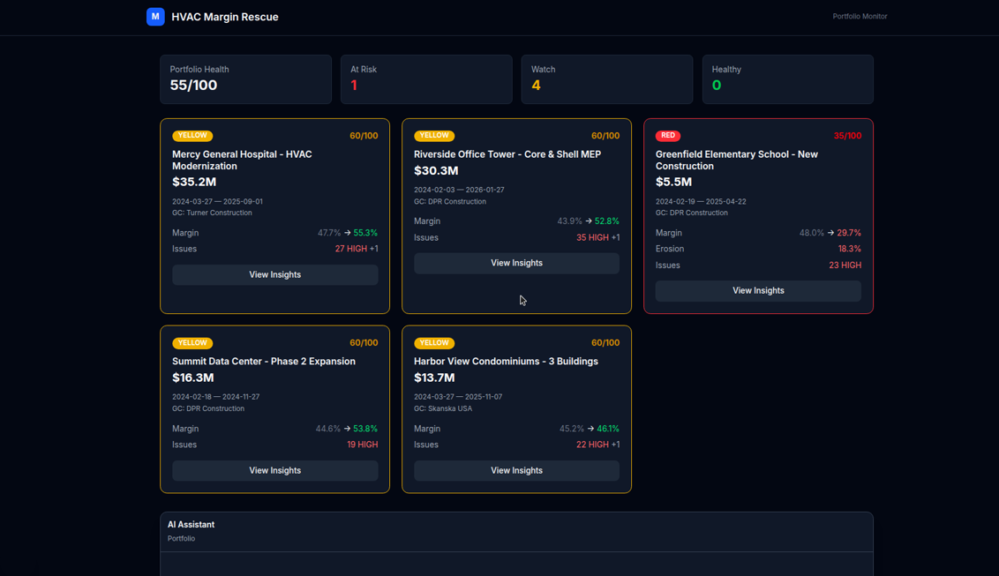
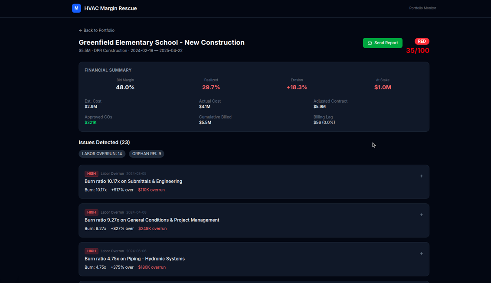
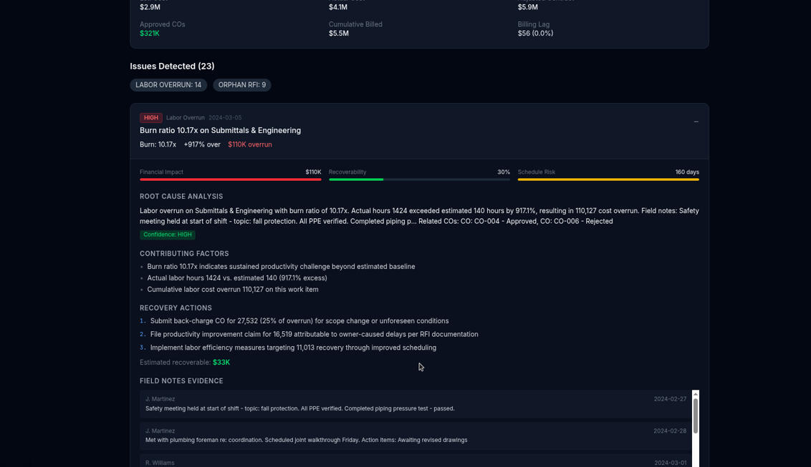

# HVAC Margin Rescue Agent

A commercial HVAC contractor bid jobs around a healthy margin and watched the money disappear by closeout. Dashboards showed the totals after the fact. This project is the thing that reads the job files, names the jobs that are slipping, and says what to do about it.

It covers five synthetic commercial projects worth **$100.9M**. One of them, Greenfield Elementary, is the problem child: bid margin **48.0%**, realized margin **29.7%**, health **35/100**.

## What it does

1. Load the portfolio (contract value, dates, general contractor).
2. Run the analysis. Each job gets a health score, a red / yellow / green status, bid vs realized margin, and a count of high-severity issues.
3. Open a project dossier. Every issue expands into a root cause, contributing factors, numbered recovery actions, a recoverable dollar estimate, and the field notes or change orders behind it.
4. Ask a follow-up in the assistant. It can look up field notes, labor by SOV line, change orders, RFIs, and a what-if margin (reject a CO, approve a CO, or recover 10% of labor).
5. Email a margin alert for that job through Gmail.

The analysis the UI shows is precomputed. "Run Real-Time Analysis" loads that result. It does not call a model.

## Stack

| Layer | Choice |
| --- | --- |
| UI | Next.js 15 (App Router), React 19, Tailwind CSS 4 |
| Chat | Vercel AI SDK 4, Google Gemini (`gemini-3.6-flash`), tool calling |
| Email | Gmail API via `googleapis` |
| Analysis pipeline | Python 3.11+, SQLite, FastAPI |
| Reasoning pass | Claude Haiku, stored on the dossiers before the UI ships |
| Data | Synthetic HVAC set in `Hackathon-5/hvac_construction_dataset/` (~18k records) |

## Architecture

```
CSVs ──► seed_db.py ──► SQLite
                           │
                           ▼
                    compute engine
                    labor, materials, billing,
                    margins, health, triggers
                           │
                           ▼
                    dossiers.json
                    (metrics + evidence + reasoning)
                           │
           ┌───────────────┴────────────────┐
           ▼                                ▼
   Next.js API routes                 /api/chat
   /api/contracts                     Gemini + tools over the
   /api/portfolio                     same JSON (notes, labor,
   /api/dossier/:id                   COs, RFIs, what-if)
   /api/email/send
```

The Python pipeline is the analyst. It loads ten CSV tables, rolls labor and material cost up to each Schedule of Values line, computes bid margin, realized margin, and billing lag, then scores each job from 100 downward. Triggers mark the day a labor line crosses 1.15× its estimate, or an RFI with cost impact never becomes a change order. A reasoning pass writes the root cause and the recovery steps onto each trigger.

The Next.js app is what you open. `scripts/prepare_static_data.py` copies the dossiers and the lookup tables into `frontend/src/data/`. The pages read those files through route handlers, so the portfolio runs without the Python server.

FastAPI (`backend/main.py`) still exposes the same portfolio, dossier, chat, and email routes against SQLite. The hackathon deploy path is the Next.js app on Vercel.

Health bands: 80–100 green, 50–79 yellow, 0–49 red.

## Setup

Node 18 or newer. From the repo root:

```bash
cd frontend
npm install
cp .env.example .env.local
npm run dev
```

Open http://localhost:3000. Load Portfolio, then Run Real-Time Analysis. The browse flow works with an empty `.env.local`.

Chat needs `GOOGLE_GENERATIVE_AI_API_KEY` in `frontend/.env.local`. Email needs `GMAIL_CREDENTIALS` and `GMAIL_OAUTH_TOKEN`. Both are described in `frontend/.env.example`. `scripts/run_gmail_auth.py` is the one-time OAuth helper.

To rebuild the SQLite database and re-check the math (Python 3.11+):

```bash
pip install -e backend
python3 -m backend.scripts.seed_db
python3 backend/tests/test_phase1.py
python3 -c "from backend.compute import run_compute_engine; run_compute_engine()"
python3 backend/tests/test_phase2.py
```

`python3 -m backend.scripts.build_dossiers` reruns reasoning. Without `ANTHROPIC_API_KEY`, pass `--no-api` and it stores metric-only fallback text. The dossiers already in `backend/data/dossiers.json` are the reasoned ones the UI uses. `python3 scripts/prepare_static_data.py` refreshes `frontend/src/data/` from those files.

## Screenshots

Taken from a local run of the Next.js app.

Portfolio after analysis. Greenfield is the only red job, and every card can open its dossier.



Greenfield Elementary: bid 48.0%, realized 29.7%, erosion +18.3%, about $1.0M at stake, 23 issues.



The first issue expanded: a 10.17× burn on Submittals & Engineering, root cause, three recovery actions, and about $33K marked recoverable, with the field notes underneath.



## Hackathon and team

Built for the [Pulse AI NYC Hackathon](https://pulse-ai-nyc-hackathon-hvac.devpost.com/) (HVAC Margin Rescue challenge) in February 2026. The brief is in `Hackathon-5/README.md`: an agent that scans a portfolio, investigates, acts, and can keep talking. The dataset is synthetic. No real project data.

Git history has two authors:

| Person | What they shipped |
| --- | --- |
| **Yashwanth Sai** | The first full build on Feb 22, 2026: SQLite load, compute engine, dossiers, Next.js UI, then the OpenAI chat, Gmail send, JSONL export, and the LLM reasoning pass. |
| **Shay Bouchles** | The Feb 24, 2026 deploy pass: one Next.js app for Vercel, chat moved to Google Gemini, and the chat function timeout raised to 30 seconds. |

## Follow-ups

The browse path is finished. These are left on purpose:

- Chat and email need the keys above. Without them the UI says so and stops.
- `gemini-2.0-flash` was shut down on June 1, 2026. Chat now calls `gemini-3.6-flash`, Google's listed replacement. That call was not exercised here because no API key was available, and the installed `@ai-sdk/google` 1.x client is older than the Gemini 3 series.
- "Run Real-Time Analysis" does not recompute. It serves `frontend/src/data/portfolio.json`.
- Four of the five jobs score exactly 60. Labor-overrun, orphan-RFI, and overdue-RFI deductions hit their caps together, so the score stops moving. Greenfield drops further because its margin erosion is large.
- Shipped dossiers contain labor-overrun and orphan-RFI triggers only. The Python engine also looks for pending change orders, billing lag, material variance, and overtime spikes. On this dataset every change order is Approved or Rejected, and billing lag is about zero, so those triggers never fire.
- Bid margins land around 44–48%. The cost model prices labor at internal burdened rates and materials at billing rates, which widens the margin versus the 15% bid in the hackathon story.
- The offline reasoning scripts still name Claude Haiku model ids. Regenerating dossiers needs a current model and an Anthropic key.
- Nothing alerts on its own. The agent runs when someone opens the app or asks a question.
